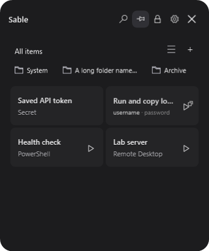
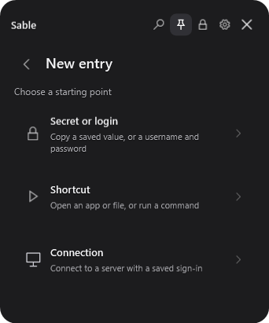

# Sable

**Keep it close. Keep it private.**

A compact Windows tray companion for the things you use every day: secrets, logins, commands, files and server connections. Copy a value, open an app or connect to a server from one small, local, encrypted vault.

[**Download for Windows x64**](https://github.com/odxxt/Sable/releases) · [Getting started](docs/USER-GUIDE.md) · [Documentation](docs/README.md) · [Roadmap](#whats-next)

<p align="center">
  
  &nbsp;
  
</p>

*Screenshots use fictional demonstration data. This documentation describes the 0.9.1 preview source; check the version on the release page when downloading.*

## A small app, useful every day

- **Start with what you need.** Choose **Secret or login**, **Shortcut**, or **Connection** when a connection module is installed. Brief descriptions and tooltips explain each choice. Add a username only when you need one.
- **Copy without the extra steps.** Click a secret to copy. A login copies its username first, then its password. Multiline secrets and sanitized HTML clipboard formatting are supported. Add an optional Run or Run and copy action without changing the secret's main copy behavior.
- **Launch your everyday tools.** Open applications, files, folders, Windows Settings or Control Panel; use Windows+R-style commands, PowerShell or CMD. Test an action before saving. Terminals stay open by default, with an option to close when finished.
- **Connect with saved sign-ins.** Optional PuTTY SSH and native Windows Remote Desktop modules keep connection credentials encrypted at rest. Their different credential-handling boundaries are documented in the [module guide](modules/README.md) and [RDP design](docs/RDP-DESIGN.md).
- **Organize without clutter.** Nested folders, direct drag-to-reorder or nest, duplication, search, compact colors and optional descriptions. Choose rows or a two-column grid independently for each folder. Overflowing folders stay in one scrollable row.
- **Keep Sable where it suits you.** A fixed, movable dark panel, a configurable global shortcut, and three modes: Tray, Always on top and Normal window. Press the pin to cycle them; the toolbar keeps its size.
- **Lock and recover.** A full password at startup, an optional 4–12 digit session PIN, five-attempt PIN protection, configurable timed locking and Windows-session locking. Recovery keys, encrypted import/export and optional two-credential backups help you move or recover your data. Backups start **off**.
- **Protect everyday copies.** Secret copies clear after 30 seconds by default if still owned by Sable. Clipboard history/cloud exclusion and supported screen-capture protection are requested. These Windows features have [limits](SECURITY.md).
- **Stay local.** No account, cloud service, telemetry, embedded browser or resident service. ZIP modules are declarative data, not executable plugins. External applications run only when invoked; an open RDP session has its own Windows process.

Existing opted-in Ping, Test port and DNS shortcuts can still suggest an action for a matching clipboard target. Matching is local and never runs anything automatically. New diagnostic presets are replaced by customizable commands; arbitrary scripts do not receive clipboard substitutions.

## New in 0.9.1 preview

- A described starter chooser, combined secret/login form, preserved drafts when changing starters, and installed-only Connection choices.
- Consistent padding, centered back controls, quieter Change labels, clearer connection icons and brief feedback when username fields change.
- Three window modes. **Only Always on top suspends timed locking**; Normal window keeps the timer active, and switching modes never resets it. Windows locking applies in every mode.
- Opt-in PowerShell variables (`$name`, `$value1` … `$value20`) through a restricted process-verified pipe, plus optional Windows UAC elevation.
- A looping native welcome illustration, hidden recovery key with in-place copy feedback, **Save key**, and a guide through creating your first real secret. The settings checklist appears after three saved entries.
- Name-sized draggable folder chips, per-folder views, in-menu entry deletion and deliberate two-step deletion of a folder and its contents.
- A simpler module manager with Installed/Add states, offline connection packages and a separate ZIP installer.

See the [entry-flow diagram](docs/ENTRY-MODEL.md), [interface notes](docs/UI-REFINEMENTS-0.9.1.md) and [full changelog](CHANGELOG.md).

## Download and start

**Standalone/portable only today. An installer edition is planned.**

Target: **Windows 10/11, x64**. The portable ZIP includes the .NET Desktop Runtime; there is no separate .NET installation step. ARM64 and 32-bit packages are not provided. See [runtime OS support](https://github.com/dotnet/core/blob/main/release-notes/10.0/supported-os.md) and the [tested-platform limits](VERIFICATION.md).

1. Download `Sable-v<version>-win-x64.zip` from [Releases](https://github.com/odxxt/Sable/releases). GitHub's automatic **Source code** archives are not the runnable app.
2. Extract the **entire ZIP** to a writable folder and open **Sable.exe**. Keep the accompanying files together.
3. Create a vault or restore an encrypted backup. Save the recovery key privately outside the vault. **Save key writes a readable file**; clicking the revealed key copies it.
4. Open Sable from its tray icon or **Ctrl+Alt+Space**, then use **+ → New entry**. The first-entry guide can walk you through saving a secret.

**Enter** saves or continues; **Shift+Enter** adds a line. Change startup behavior and the shortcut in Settings → App preferences. Close hides the panel; Settings → **Quit → Confirm quit** exits it.

Each release includes `SHA256SUMS-v<version>.txt`. Compare its checksum with your downloaded ZIP, for example:

```powershell
# Replace <version> with the version you downloaded.
Get-FileHash '.\Sable-v<version>-win-x64.zip' -Algorithm SHA256
```

### Updating

Quit the old app, extract the new release separately, and copy your **entire data folder** beside the new executable. Fresh installs use `Sable-data`; keep an existing `SableLatch-data` name because Sable detects it automatically. Include attachments and retain the original as a rollback copy. Open on the same Windows account/computer, or use recovery when moving environments. Do not run two versions against one vault or alternate older builds on newer data. See [the upgrade guide](docs/USER-GUIDE.md#updating-or-moving).

## Encryption, explained

Sable uses established cryptographic primitives. These links describe the underlying algorithms; they are not a certification or audit of this application.

| Component | How Sable uses it | Reference |
| --- | --- | --- |
| **AES-256-GCM** | Authenticated encryption for vault data, attachments and encrypted envelopes, with fresh 96-bit nonces, 128-bit authentication tags and purpose-bound associated data. | [NIST SP 800-38D](https://csrc.nist.gov/pubs/sp/800/38/d/final) |
| **Argon2id** | Password-based key derivation: 64 MiB memory, 3 passes, 1 lane, a random 128-bit salt and a 256-bit output. | [RFC 9106](https://www.rfc-editor.org/rfc/rfc9106) |
| **RSA-3072 / OAEP-SHA256** | Wraps each backup's fresh AES key. The private key is itself encrypted under the backup password. | [RFC 8017](https://www.rfc-editor.org/rfc/rfc8017) |
| **ECDSA P-256 / SHA-256** | Verifies official module manifests and the GitHub catalog against the embedded publisher key. | [NIST FIPS 186-5](https://csrc.nist.gov/pubs/fips/186-5/final) |
| **HMAC-SHA256** | Combines a process-only random secret with the PIN-derived key for quick-unlock sessions. The PIN is not a replacement for the vault password. | [RFC 2104](https://www.rfc-editor.org/rfc/rfc2104) |
| **SHA-256** | Recovery-key typo checks, configuration fingerprints and clipboard ownership checks; not the password KDF. | [NIST FIPS 180-4](https://csrc.nist.gov/pubs/fips/180-4/upd1/final) |
| **Windows DPAPI** | Protects normal access using the Windows user context and app-specific machine identity. This is Windows protection, not a standalone encryption algorithm or TPM guarantee. | [Microsoft CryptProtectData](https://learn.microsoft.com/en-us/windows/win32/api/dpapi/nf-dpapi-cryptprotectdata) |

Recovery keys contain **256 cryptographically random bits**. Random salts prevent reusable rainbow tables; Argon2id makes guessing more costly. Offline files cannot enforce an attempt limit, so strong, unique passwords still matter.

### Which credential opens which file?

| Operation | What you need |
| --- | --- |
| Normal vault access | App password on the registered Windows environment; optionally a PIN after the first password unlock in a running session. |
| Recover a moved vault or forgotten app password | Master recovery key and the complete vault data folder. |
| Restore a `.sablebackup` | That backup's password **and** its original recovery key. |
| Import a `.sableexport` | Its export password. The vault recovery key does not recover a forgotten export password. |

This is a **preview**, not an independently audited password manager. Capture exclusion depends on the recording method; it cannot block every recorder or camera. Advanced actions run with your Windows account's permissions and are not sandboxed. See the [security design and limits](SECURITY.md) before storing important data.

## What's next

The direction is a small app with room to grow. Checked items are available now; unchecked items are planned without a promised release date:

- [x] **Declarative ZIP modules:** installation, enable/disable controls, beginner samples, API 1 field/action contracts and the first PuTTY module.
- [x] **Local Remote Desktop:** click to launch Windows Remote Desktop, with an optional Launch & copy preference. A temporary Windows-encrypted connection file is used; see the [security limits](docs/RDP-DESIGN.md).
- [x] **Module trust and permissions:** signed official packages, community warnings and scoped host-operation consent.
- [ ] **More module capabilities:** encrypted SSH-key authentication, additional RDP options, and a separately reviewed sandbox for executable extensions.
- [ ] **More entry types:** image/screenshot and attachment providers that use the existing encrypted storage and clipboard contracts.
- [ ] **A Windows installer:** alongside the portable version, with a straightforward upgrade path.
- [ ] **Additional languages:** selectable translations with right-to-left and left-to-right layouts.
- [ ] **Trusted release delivery:** signed builds and an update experience that preserves local vaults.
- [ ] **Further hardening and performance work:** broader Windows/DPI testing, recovery testing across machines, independent security review and improvements for larger collections.

The current app already separates content, storage, clipboard, editors, layouts and toolbar actions. External **declarative ZIP modules are available**. Arbitrary executable plugins and external layout/toolbar contributions remain disabled. The [extension guide](EXTENSIONS.md) and [screenshot-provider example](examples/ScreenshotProvider.cs) explain the foundation.

## Build it yourself

Install a **.NET 10 SDK on Windows**, then run:

```powershell
git clone https://github.com/odxxt/Sable.git
cd Sable
.\build.ps1 -Portable
```

The script runs the core and Windows module checks, then publishes the self-contained app to `artifacts/Sable-portable`. Some native checks require a normal Windows user session. For development:

```powershell
dotnet run --project tests/SableLatch.Tests
dotnet run --project src/SableLatch.Desktop
```

The current update passed **305 core checks and 53 focused native UI checks**, plus self-contained Release publishing. These counts do not imply live SSH/RDP, UAC, every DPI or every Windows build was tested. [VERIFICATION.md](VERIFICATION.md) records current coverage, historical results and remaining manual checks.

## Explore and contribute

Found a bug or have an idea? [Open an issue](https://github.com/odxxt/Sable/issues) with the app version, Windows version and reproduction steps. Use fictional data; never attach vaults, passwords or recovery keys.

- [Documentation index](docs/README.md) — current guides and clearly separated historical notes.
- [User guide](docs/USER-GUIDE.md) — setup, controls, settings, backup and recovery.
- [Entry model](docs/ENTRY-MODEL.md) — starters, click behavior and PowerShell fields.
- [Module author guide](modules/README.md) — ZIP samples, supported capabilities and catalog trust.
- [Architecture](ARCHITECTURE.md), [Security](SECURITY.md) and [Extensions](EXTENSIONS.md) — implementation and boundaries.
- [Publishing](docs/PUBLISHING.md) — source updates, portable releases and the signed catalog.

## License

Sable uses the **[MIT License](LICENSE)**. Third-party components retain their own terms; see [THIRD-PARTY.md](THIRD-PARTY.md).
