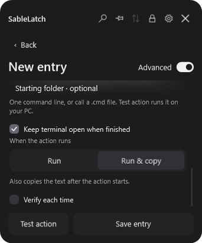

# SableLatch

**Keep it close. Keep it private.**

A compact encrypted clipboard vault for Windows. Save the text, secrets and logins you reach for every day, then copy them from a quiet tray popup and get back to what you were doing.

[**Download v0.8.0 for Windows x64**](https://github.com/odxxt/SableLatch/releases/download/v0.8.0/SableLatch-v0.8.0-win-x64.zip) · [All releases](https://github.com/odxxt/SableLatch/releases) · [User guide](docs/USER-GUIDE.md) · [Roadmap](#whats-next)

<p align="center">
  
  &nbsp;
  
</p>

*Screenshots use fictional demonstration data.*

## A little vault for everyday things

- **One click to copy.** Store ordinary text, masked secrets or logins. A login copies its username first and password on the next click, keeping the panel available between them.
- **Small, calm and close at hand.** A rounded dark panel, subtle feedback, a configurable keyboard shortcut and a pin to keep it open. Unpinned, it stays out of the taskbar and Alt+Tab by default.
- **Organize your own way.** Folders, search, direct row dragging and folder drops, compact entry colors and multiline text or secrets. Reveal a secret only when you choose.
- **Useful advanced actions.** Open an application, find Windows Settings or Control Panel pages, use a Windows+R-style command, or run CMD/PowerShell. Choose Run or Run & copy, test before saving, with terminals staying open by default.
- **Keep useful formatting.** Paste formatted content into an empty Text entry to retain common HTML formatting and tables when copying to supporting apps. Plain text remains available as a fallback; no embedded browser.
- **Lock when it matters.** A full password at startup, optional 4–12 digit quick PIN during that process session, configurable timed locking and Windows session locking. Five incorrect PINs require the full password. Pinning pauses the timer, but never overrides Windows locking.
- **Thoughtful clipboard handling.** Secret copies clear after 30 seconds by default if still owned by SableLatch. The delay is configurable; Windows clipboard-history exclusion and supported screen-capture exclusion are requested.
- **Your data stays local.** An encrypted vault, encrypted import/export and optional encrypted backups. Backups start **off**. No account, cloud service, telemetry, browser engine or resident background service. Each open RDP session uses a separate local process.
- **Add your own entry types.** Install declarative ZIP modules, use protected PuTTY SSH and Remote Desktop entries, or start with the quick-note sample. See the [module guide](modules/README.md). No background module tasks or executable plugin code.
- **Recover and review.** A master recovery key, configurable encrypted Trash for secrets, entry timestamps and a small protected activity history that can be exported to an HTML report.

## Download and start

**Currently available: standalone/portable only. An installer edition is planned.**

Target: **Windows 10/11, x64**. The ZIP includes the .NET Desktop Runtime; you do not need to install .NET separately to run it. ARM64 and 32-bit packages are not currently provided. See [runtime OS support](https://github.com/dotnet/core/blob/main/release-notes/10.0/supported-os.md) and [verification limits](VERIFICATION.md) for platform details.

1. Download **SableLatch-v0.8.0-win-x64.zip** from the [release page](https://github.com/odxxt/SableLatch/releases/tag/v0.8.0). GitHub's automatic **Source code** archives are for developers, not the runnable app.
2. Extract the **entire ZIP** to a writable folder. Keep all included files together.
3. Open **SableLatch.exe**. Create a vault or restore an existing encrypted backup.
4. Save your recovery key somewhere safe outside the app. It is shown during setup and is not available to reveal again later.
5. Open SableLatch from the tray or press **Ctrl+Alt+Space**. Use **+ → New entry** and click its row to copy.

You can change the shortcut and startup behavior in Settings. **Enter** saves or continues; **Shift+Enter** adds a line. The close button hides the panel. Settings → **Quit → Confirm quit** exits the app.

Checksums are included with each release as `SHA256SUMS-v0.8.0.txt`. To check a download in PowerShell:

```powershell
Get-FileHash .\SableLatch-v0.8.0-win-x64.zip -Algorithm SHA256
```

### Updating

Exit the old app, extract the new release separately, and copy your **entire `SableLatch-data` folder** beside the new executable. Include its attachments and keep the old folder as a rollback copy. Open the new version on the same Windows account/computer. Do not run two versions against the same vault or alternate older builds on newer data.

## Encryption, explained

SableLatch uses established cryptographic primitives. These links describe the underlying algorithms; they are not a certification or audit of this application.

| Component | How SableLatch uses it | Reference |
| --- | --- | --- |
| **AES-256-GCM** | Authenticated encryption for vault data, attachments and encrypted envelopes, with fresh 96-bit nonces, 128-bit authentication tags and purpose-bound associated data. | [NIST SP 800-38D](https://csrc.nist.gov/pubs/sp/800/38/d/final) |
| **Argon2id** | Password-based key derivation: 64 MiB memory, 3 passes, 1 lane, a random 128-bit salt and a 256-bit output. | [RFC 9106](https://www.rfc-editor.org/rfc/rfc9106) |
| **RSA-3072 / OAEP-SHA256** | Wraps each backup's fresh AES key. The private key is itself encrypted under the backup password. | [RFC 8017](https://www.rfc-editor.org/rfc/rfc8017) |
| **ECDSA P-256 / SHA-256** | Verifies official module manifests and the GitHub catalog against the embedded publisher key. | [NIST FIPS 186-5](https://csrc.nist.gov/pubs/fips/186-5/final) |
| **HMAC-SHA256** | Combines a process-only random secret with the PIN-derived key for quick-unlock sessions. The PIN is not a replacement for the vault password. | [RFC 2104](https://www.rfc-editor.org/rfc/rfc2104) |
| **SHA-256** | Recovery-key typo checks, configuration fingerprints and clipboard ownership checks; not the password KDF. | [NIST FIPS 180-4](https://csrc.nist.gov/pubs/fips/180-4/upd1/final) |
| **Windows DPAPI** | Protects normal access using the Windows user context and app-specific machine identity. This is Windows protection, not a standalone encryption algorithm or TPM guarantee. | [Microsoft CryptProtectData](https://learn.microsoft.com/en-us/windows/win32/api/dpapi/nf-dpapi-cryptprotectdata) |

Recovery keys contain **256 cryptographically random bits**. Random salts prevent reusable rainbow tables; Argon2id makes guessing more costly. Offline files cannot enforce an attempt limit, so strong, unique passwords still matter.

### Which credential opens which file?

| Operation | What you need |
| --- | --- |
| Normal vault access | App password on the registered Windows environment; optionally a PIN after the first password unlock in a running session. |
| Recover a moved vault or forgotten app password | Master recovery key and the complete vault data folder. |
| Restore a `.sablebackup` | That backup's password **and** its original recovery key. |
| Import a `.sableexport` | Its export password. The vault recovery key does not recover a forgotten export password. |

This is a **preview**, not an independently audited password manager. Capture exclusion depends on the recording method; it cannot block every recorder or camera. Advanced actions run with your Windows account's permissions and are not sandboxed. See the [security design and limits](SECURITY.md) before storing important data.

## What's next

The direction is a small app with room to grow. Checked items are available now; unchecked items are planned without a promised release date:

- [x] **Declarative ZIP modules:** installation, enable/disable controls, beginner samples, API 1 field/action contracts and the first PuTTY module.
- [x] **Local Remote Desktop:** click a saved entry to open a dedicated RDP window, with protected local credential delivery and no password files.
- [x] **Module trust and permissions:** signed official packages, community warnings and scoped host-operation consent.
- [ ] **More module capabilities:** encrypted SSH-key authentication, additional RDP options, and a separately reviewed sandbox for executable extensions.
- [ ] **More entry types:** image/screenshot and attachment providers that use the existing encrypted storage and clipboard contracts.
- [ ] **A Windows installer:** alongside the portable version, with a straightforward upgrade path.
- [ ] **Additional languages:** selectable translations with right-to-left and left-to-right layouts.
- [ ] **Trusted release delivery:** signed builds and an update experience that preserves local vaults.
- [ ] **Further hardening and performance work:** broader Windows/DPI testing, recovery testing across machines, independent security review and improvements for larger collections.

The current app already separates content, storage, clipboard, editors, layouts and toolbar actions. External **declarative ZIP modules are available**. Arbitrary executable plugins and external layout/toolbar contributions remain disabled. The [extension guide](EXTENSIONS.md) and [screenshot-provider example](examples/ScreenshotProvider.cs) explain the foundation.

## Build it yourself

Install a **.NET 10 SDK on Windows**, then run:

```powershell
git clone https://github.com/odxxt/SableLatch.git
cd SableLatch
.\build.ps1 -Portable
```

The script runs the core checks and publishes the standalone app to `artifacts/SableLatch-portable`.

For development:

```powershell
dotnet run --project tests/SableLatch.Tests
dotnet run --project src/SableLatch.Desktop
```

The v0.8.0 preview is covered by core/storage/package checks, WPF interaction checks and native credential-pipe tests, including a real PuTTY 0.85 pipe-reader check. Full registry-backed launch testing needs a normal Windows session. See [VERIFICATION.md](VERIFICATION.md) for what was tested and what remains unverified.

## Explore and contribute

Found a bug or have an idea? [Open an issue](https://github.com/odxxt/SableLatch/issues). Include the app version, Windows version and steps to reproduce. Use fictional entries in screenshots and examples; never attach your vault, passwords or recovery key.

- [User guide](docs/USER-GUIDE.md) — everyday controls, settings and recovery.
- [RDP design](docs/RDP-DESIGN.md) — the approved connection approach, not yet implemented.
- [Publishing and catalog](docs/PUBLISHING.md) — source pushes, app releases and signed module updates.
- [Architecture](ARCHITECTURE.md) — how the parts fit together.
- [Security](SECURITY.md) — encryption, threat boundaries and verification limits.
- [Extensions](EXTENSIONS.md) — the modular foundation and future add-ons.
- [Changelog](CHANGELOG.md) — what's changed.

## License

SableLatch is licensed under the **[MIT License](LICENSE)**. Third-party components retain their own licenses; see [THIRD-PARTY.md](THIRD-PARTY.md).
