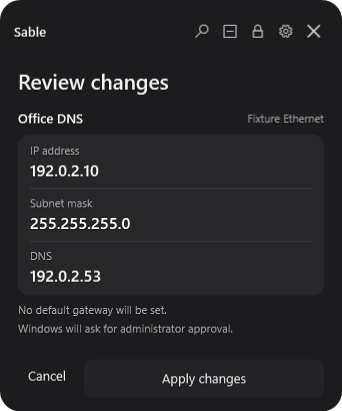

# Sable

Sable keeps secrets, logins, shortcuts and server connections close at hand in a compact Windows tray app with a local encrypted vault.

[**Download Sable for Windows x64**](https://github.com/odxxt/Sable/releases/tag/v9.8.0) · [User guide](docs/USER-GUIDE.md) · [Documentation](docs/README.md)

  
  &nbsp;
  

## Latest updates

- **Network change entries.** Save an adapter’s IPv4 or DNS settings and apply them from a single entry. Add either change or both, edit the dotted address fields, and review the values before applying.
- **Modules from GitHub.** Install signed official modules through **Settings → Plugins & modules → GitHub catalog**. You can also install a module ZIP you already downloaded.
- **Quieter clipboard suggestions.** Ping, Test port and DNS lookup suggestions use steady cards with separate Run and Dismiss controls.

See the [changelog](CHANGELOG.md) for earlier releases.

## What you can do

- Copy secret values, formatted text or login credentials. Sensitive copies clear after 30 seconds by default if Sable still owns the clipboard.
- Launch apps, files and commands. Optional modules add **PuTTY SSH**, **Windows Remote Desktop**, **Type clipboard** and **Network change** entries.
- Organize entries in nested folders with search, drag and drop, and row or grid views.
- Unlock with a password and an optional session PIN. Use the recovery key, encrypted exports or optional backups to recover or move data.

## Get started

Sable is available as a portable app for **Windows 10 and 11, x64**. The ZIP includes the .NET Desktop Runtime. An installer is planned.

1. Download **Sable-v9.8.0-win-x64.zip** from the [release page](https://github.com/odxxt/Sable/releases/tag/v9.8.0).
2. Extract the entire ZIP to a writable folder and open **Sable.exe**.
3. Create or restore your vault. Keep your recovery key somewhere private outside the vault.
4. Open Sable from the tray or press **Ctrl+Alt+Space**, then choose **+ → New entry**.

When updating, quit Sable first and copy your full data folder beside the new executable. See the [upgrade guide](docs/USER-GUIDE.md#updating-or-moving) for details. Compare the ZIP’s SHA-256 with the checksum file on the release page if you want to verify your download.

## Security

| Component | Purpose |
| --- | --- |
| [AES-256-GCM](https://csrc.nist.gov/pubs/sp/800/38/d/final) | Authenticated encryption for vaults, attachments and encrypted transfers |
| [Argon2id](https://www.rfc-editor.org/rfc/rfc9106) | Password key derivation with a random salt |
| [RSA-OAEP](https://www.rfc-editor.org/rfc/rfc8017) | Wraps encrypted backup keys |
| [ECDSA P-256](https://csrc.nist.gov/pubs/fips/186-5/final) | Verifies official module and catalog signatures |
| [HMAC-SHA256](https://www.rfc-editor.org/rfc/rfc2104) | Protects session PIN unlock alongside a process-only secret |
| [SHA-256](https://csrc.nist.gov/pubs/fips/180-4/upd1/final) | Checksums and fingerprints |
| [Windows DPAPI](https://learn.microsoft.com/en-us/windows/win32/api/dpapi/nf-dpapi-cryptprotectdata) | Protects local access with the Windows user context |

Sable is an unaudited preview. Read the [security design and limits](SECURITY.md) for recovery, clipboard, screen capture and external actions.

## Build and contribute

With the .NET 10 SDK on Windows, clone the repository and run:

~~~powershell
.\build.ps1 -Portable
~~~

The script builds the portable app and runs storage and module checks. See [verification](VERIFICATION.md), the [module author guide](modules/README.md), and the [architecture](ARCHITECTURE.md). For a bug report, include the app and Windows versions and reproduce it with fictional data. [Open an issue](https://github.com/odxxt/Sable/issues)

Planned work includes a Windows installer, more module capabilities and entry types, and selectable languages.

## License

[MIT](LICENSE). See [third-party notices](THIRD-PARTY.md).

## Token usage

| Direction | Tokens |
| --- | ---: |
| Input, including cached tokens | 301,249,238 |
| Output | 1,482,757 |
| **Total** | **302,731,995** |

Codex session snapshot recorded on 24 November 2026 during release preparation.
