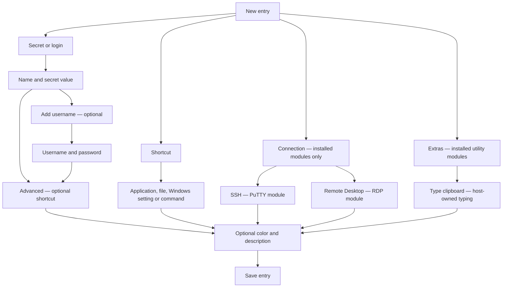

# Choose a starter

Sable keeps one encrypted entry model and offers up to four focused starting points. Open **+ → New entry** to see short descriptions and tooltips, without a long template dropdown or module installation inside the editor.



| Starter | Main entry click | Extra controls |
|---|---|---|
| Secret or login | Copy the secret; with a username, copy username then password | Advanced → Include a shortcut adds an independent Run / Run and copy button |
| Shortcut | Run by default | All existing action types, script fields, administrator mode, terminal preferences, verification, and optional copying |
| Connection | Launch by default | Installed SSH/RDP providers; **More options** below the credentials; optional copy behavior |
| Extras | Run the selected tool | Type clipboard entries inherit module defaults or supply their own timing/mode settings |

**Add username / Remove username** sits above the credential inputs. Without a username, the field is labelled **Secret value**. Adding a username changes it to **Password** and reveals **Username**. The changed fields briefly fade in, respecting the Windows animation preference. Both values survive toggling while editing. A removed username is not included in the saved secret.

New entries retain their drafts while using **Change** or Back between starters. The latest name is shared; other fields, actions, colors and descriptions stay with their starter. Leaving the editor or locking discards drafts. Editing existing entries and duplicates opens their form directly.

**Connection** appears only when at least one installed, enabled module declares a supported connection handler. The host routes `putty` and `rdp` handlers into this section; field modules remain separate starters. Disabling/uninstalling removes the choice, not existing encrypted entries. Packages do not supply executable UI or access the vault. Installing modules remains in **Settings → Plugins & modules**. A future connection protocol needs a reviewed host handler; declaring an arbitrary name does not grant new capabilities.

**Color & description** provides compact swatches and optional tooltip text consistently for secrets, shortcuts and connections. Secret values never appear in entry tooltips.

**Advanced → Include a shortcut** keeps the secret/login row as a copy target. The separate action can be **Run** or **Run and copy**. For a login, Run and copy launches once and copies the username; the next row click copies the password without launching again. In Tray mode, the panel remains open for the username and closes after the password according to clipboard settings. Both kept-open modes remain open after copying; Normal window never takes temporary topmost status.

Shortcut starters have no connection option. They retain Application, File or folder, Windows & Control Panel, Run, PowerShell and CMD. Existing diagnostic actions remain editable. Test action stays one third of the fixed footer, alongside Save; saving an enabled action requires a successful test of its current configuration. Color alone does not require testing.

Existing entries keep their saved behavior until edited. Saving a secret/login with this editor sets its row to Copy and configures its action separately. Shortcut and connection click behavior stays configurable. No vault format, encryption, module signature or credential-transport changes are required.

## Script fields

PowerShell actions have an explicit **Pass this entry's fields to PowerShell** option, off by default. The mapping is:

| Variable | Secret | Login | Command |
|---|---|---|---|
| `$name` | Entry name | Entry name | Entry name |
| `$value1` | Secret value | Username | Custom field |
| `$value2` | Optional custom field | Password | Custom field |
| `$value3` … `$value20` | Optional encrypted fields | Optional encrypted fields | Optional encrypted fields |

Use **Script fields · optional** to add or remove custom values. Adding a username changes the built-in mapping and requires retesting an enabled action. If a secret already has a custom `$value2`, move that value to an unused custom field before adding a username, so it cannot collide with the password binding. Values are data variables, never string replacement in script source. For example, a command entry could store a hostname as `$value1` and use:

```powershell
Test-Connection -ComputerName $value1 -Count 4
```

Do not turn an untrusted value into executable code with `Invoke-Expression`. Scripts run with the permissions you grant them and can disclose values you pass. CMD remains available for ordinary scripts; secret-variable binding is PowerShell-only. Windows UAC handles **Run as administrator** for supported application and command actions.

Ping, DNS lookup and Test port are removed from the new-action picker. Existing diagnostic entries remain readable and runnable; built-in clipboard diagnostics now work independently of entries, so their old suggestion opt-in is no longer needed. No saved actions are silently deleted. Generic clipboard-to-script binding is not enabled.

## Storage and transport

Entry descriptions, click behavior, custom fields and folder layouts are additive encrypted document properties. Content/module IDs and vault cryptographic identifiers are unchanged. Modules still cannot read secret fields. Password copying for SSH/RDP and script-value delivery are explicit trusted-host capabilities.

PowerShell receives a JSON packet through a random, first-instance, local-only named pipe restricted to the current Windows SID. Before delivering bytes, Sable verifies the client PID against the live process handle it launched. The command line contains a fixed loader and pipe name, not the user script or bound values. The handoff has a deadline and is cancelled when Sable locks; established scripts are not terminated on later lock. Failed pending handoffs stop only the process just launched.

Host byte buffers are zeroed after transfer. Managed strings and child-process memory cannot be guaranteed to be wiped immediately. PowerShell/security logging, debuggers, or scripts that print or transmit values may expose them. Sable does not suppress auditing, bypass policy, or promise protection against administrator-level inspection. A UAC prompt using a different Windows account cannot receive this user's pipe data.

References: [Windows named-pipe access checks](https://learn.microsoft.com/en-us/windows/win32/ipc/named-pipe-security-and-access-rights), [client PID verification](https://learn.microsoft.com/en-us/windows/win32/api/winbase/nf-winbase-getnamedpipeclientprocessid), [PowerShell logging](https://learn.microsoft.com/en-us/powershell/module/microsoft.powershell.core/about/about_logging?view=powershell-5.1).
